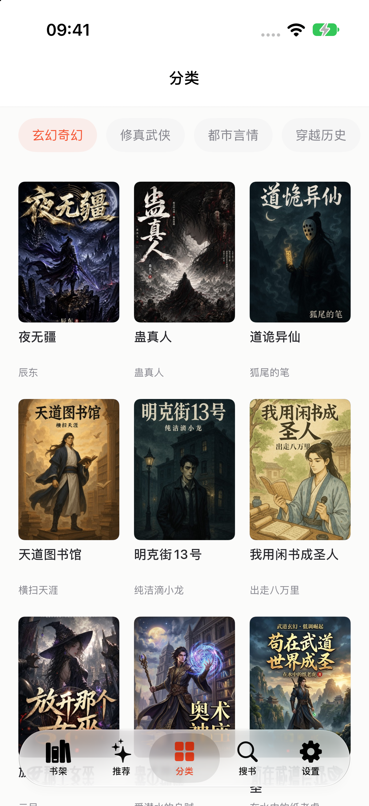
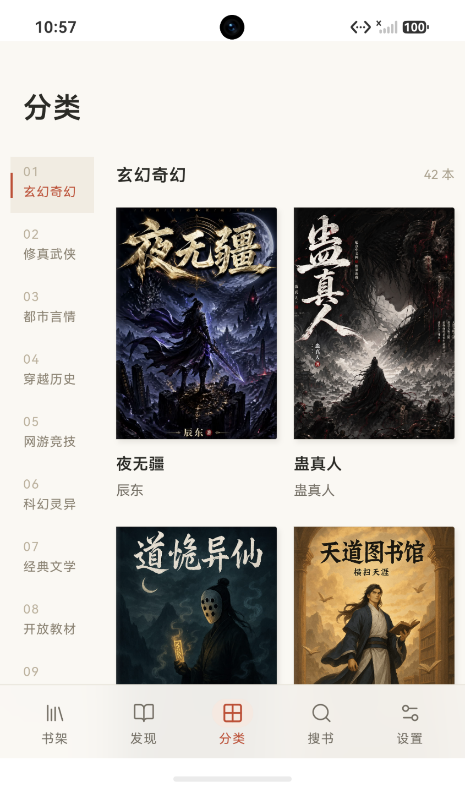

# 清读 · QingRead

免费无广告的多端阅读器，支持多源搜书、EPUB / PDF / TXT、离线阅读与自建服务器同步。提供 iPhone、Web、Android 和 HarmonyOS 测试版。

[下载与使用](#下载与使用) · [本地运行](#开始使用) · [自建服务器](web/deploy/README.md) · [文档](docs/README.md) · [反馈问题](https://github.com/SakuraWang6/QingRead/issues)

## 下载与使用

| 平台 | 入口 | 当前使用方式 |
| --- | --- | --- |
| Android | [下载 APK](https://github.com/SakuraWang6/QingRead/releases/download/v0.12.0/QingRead-Android-0.12.0.apk) | 当前 0.12.0，约 7.3 MB；下载后按系统提示允许浏览器安装，同签名旧版可覆盖升级 |
| Web | [打开清读](https://192.144.237.46/qingread/) | 手机、平板或电脑浏览器直接使用，无需安装 |
| iPhone | [Xcode 安装说明](docs/development.md#iphone) | 需要 Mac、Xcode 和自己的 Apple 账号签名安装；暂未提供 App Store 或 IPA 下载 |
| HarmonyOS · 测试版 | [下载未签名 HAP](https://github.com/SakuraWang6/QingRead/releases/download/v0.12.0/QingRead-HarmonyOS-0.12.0-unsigned.hap) · [签名说明](docs/harmony-build.md) | 需用 DevEco Studio 配置自己的签名后安装真机；暂未提供可直接安装的签名包 |

Android 也可使用[服务器备用下载](https://192.144.237.46/downloads/QingRead-Android-latest.apk)，运行需要 Android System WebView 125 或以上。iPhone 和鸿蒙暂不安装 App 时，也可以使用上方 Web；iPhone 可在 Safari 中选择「分享 → 添加到主屏幕」。

安装包和 SHA-256 校验文件统一放在 [Releases 下载区](https://github.com/SakuraWang6/QingRead/releases/tag/v0.12.0)，不提交进源码历史；签名私钥、账号数据与个人描述文件不发布。鸿蒙未签名包目前仅在官方模拟器验证，不能直接转发给朋友在任意手机安装。

## 界面预览

iPhone、Web 与鸿蒙版的实际分类页，截图中可见封面均已加载。版本与测试设备见[截图说明](docs/previews/README.md)。

<table>
  <tr>
    <th>iPhone · 分类</th>
    <th>Web · 手机分类</th>
    <th>HarmonyOS · 模拟器</th>
  </tr>
  <tr>
    <td align="center"></td>
    <td align="center"></td>
    <td align="center"></td>
  </tr>
</table>

[截图与版本信息](docs/previews/README.md)

## 核心功能

- **搜书与发现**：多来源搜索、文学与开放教材、完结书单、作者作品。
- **阅读与听书**：滑动、覆盖、滚动翻页，调整字号、行距、段距与背景；系统语音与定时停止，iPhone 可选离线 AI 音色。
- **追更与离线**：新增章节提醒、换源保留进度、自动预读、可暂停和重试的下载管理。
- **书架与同步**：置顶、分组、在读／待读／读完；自建服务同步书架、阅读位置、笔记与原文件，账号各自隔离。
- **书签与搜索**：长按正文整段记个人笔记、搜索本机已缓存正文，PDF 支持页书签与本地文字搜索。
- **电子书**：EPUB 默认文字阅读，可进入「原版」查看插图、层级标题与脚注；PDF 保留页面图表，TXT 按章节阅读。
- **关于清读**：查看安装版本、手动检查更新、阅读使用说明与许可；按平台提示更新，保留阅读数据。

## 平台

| 平台 | 使用方式 | 说明 |
| --- | --- | --- |
| iPhone | SwiftUI 原生 App | PDFKit、系统后台传输、可选离线 AI 听书；通过 Xcode 构建安装 |
| Web | 手机或桌面浏览器 | 移动端布局、PWA、可选 Web Push 与云端准备章节 |
| Android | Capacitor App | 复用 Web 阅读器，接入前台下载服务、WorkManager、系统返回键与 KeyStore |
| HarmonyOS · 测试版 | ArkTS / ArkWeb Stage App | 系统离线语音、电量、安全存储、备份保存和后台传输；较新系统支持定期追更本地通知 |

后台能力由系统控制：iPhone 免费个人签名不支持原生 APNs，远程推送请使用 iOS 16.4+ 的主屏幕 PWA，并登录、主动授权。浏览器关闭后，云端准备可继续，但需回到前台把正文保存到本机。Web / Android 听书使用系统语音；Android 尚无真机验证。详见[平台工作流](docs/reading-workflows.md)。

鸿蒙版目标 SDK 26，最低兼容配置为 HarmonyOS 5.0（API 12），已在官方 HarmonyOS 7 模拟器验证。定期追更通知仅在 API 23 及以上启用，由系统尽力调度；后台下载需登录自建服务并先完成云端准备，返回前台校验后才计入本机缓存。锁屏听书、远程推送及 iPhone 的离线 AI 引擎尚未接入。当前 HAP 未签名，真机与旧系统待测，安装需自行配置签名。见 [HarmonyOS 指南](harmony/README.md)与[构建说明](docs/harmony-build.md)。

## 开始使用

### 本地运行 Web

需要 Node.js 24、npm 与 Python 3.10+（生成共用版本清单）：

```sh
git clone https://github.com/SakuraWang6/QingRead.git
cd QingRead/web
npm ci
npm run dev
```

打开 <http://127.0.0.1:5173>。命令会同时启动网页和书源服务；内置公版《桃花源记》，可直接体验阅读。

完整命令与浏览器说明见 [Web 指南](web/README.md)。

### 安装到手机

- **iPhone**：在 Mac 用 Xcode 打开 `QingRead.xcodeproj`，选择自己的 Apple Team，连接 iPhone，按提示启用开发者模式后运行。模拟器无需真机签名；免费个人签名通常 7 天有效。见 [iPhone 构建](docs/development.md#iphone) 与 [签名和续签](docs/sideloading.md)。
- **Android**：直接使用[上方安装包](#下载与使用)。需要自行构建时，见 [Android 指南](web/android/README.md)或 [Android debug APK 工作流](https://github.com/SakuraWang6/QingRead/actions/workflows/android.yml)；CI 调试包使用临时签名，不能保证覆盖安装上方固定签名包。
- **HarmonyOS（测试版）**：使用官方 DevEco Studio 打开 `harmony/`，生成 Web 资源；真机运行需用自己的华为开发者账号配置调试证书、Profile 和设备。当前未签名 HAP 已在 HarmonyOS 7 官方模拟器运行，真机尚未验证。见[构建与签名说明](docs/harmony-build.md)。

### 开启跨设备同步

可使用上方 Web 在线实例，也可按 [部署指南](web/deploy/README.md) 自建 HTTPS 服务。App 接入当前在线实例时，服务地址填写 `https://192.144.237.46`；各设备连接同一服务器并登录同一账号，即可同步书架、整理状态、当前位置、书签笔记与 EPUB / PDF / TXT 原文件。朋友使用独立账号即可分别保存数据。同步范围、冲突处理及备份见 [云同步说明](docs/cloud-sync.md)。

源码和自行构建的客户端不预设公共服务器地址；不登录时，书架和文件保存在当前设备。

## 书源与文件

内置来源涵盖网络小说、经典文本、公版电子书与开放教材。来源列表、规则格式和验证范围见 [书源说明](docs/sources.md)。原站改版、限流或网络问题可能影响搜索与下载；已缓存正文仍可继续阅读。

新增「白鹿书院 · 外国文学」，补充《教父》等外国小说检索。旧版 iPhone 可[导入书源 JSON](docs/book-sources/bailushuyuan.json)，步骤见[文学书源说明](docs/sources.md#旧版-iphone-补充文学书源)。

EPUB 默认使用文字模式续读，并提供「原版」入口；原版禁止作者脚本和外部资源，特殊排版可能与出版者阅读器不同。PDF 暂不支持听书与图片文字识别（OCR）。加密或 DRM 文件不在当前支持范围内。

## 项目结构与文档

| 路径 | 内容 |
| --- | --- |
| `App/` | iPhone 原生界面、阅读器、书架与听书 |
| `Sources/ReadingCore/` | 书源模型、网络请求、搜索与正文解析 |
| `Sources/ReadingProbe/` | 实际书源链路检查工具 |
| `Tests/` | Swift 核心回归测试 |
| `web/` | Web 界面、API、账号同步与 Android 工程 |
| `harmony/` | HarmonyOS ArkTS / ArkWeb 工程与原生能力桥接 |
| `scripts/` | 工程生成、诊断、签名与维护工具 |
| `docs/` | 使用、开发、部署及验证文档 |

- [文档导航](docs/README.md)
- [开发与验证](docs/development.md)
- [追更、换源与下载](docs/reading-workflows.md)
- [书架、笔记与电子书](docs/reading-tools.md)
- [关于清读与客户端更新](docs/app-updates.md)
- [HarmonyOS 工程](harmony/README.md)与[构建说明](docs/harmony-build.md)
- [已测范围与已知限制](docs/verification.md)
- [本地维护与清理](docs/maintenance.md)
- [问题反馈](CONTRIBUTING.md)

## 许可

本项目采用 [Polyform Strict 1.0.0](LICENSE)。第三方依赖与模型的许可见 [许可说明](docs/licensing.md)。
